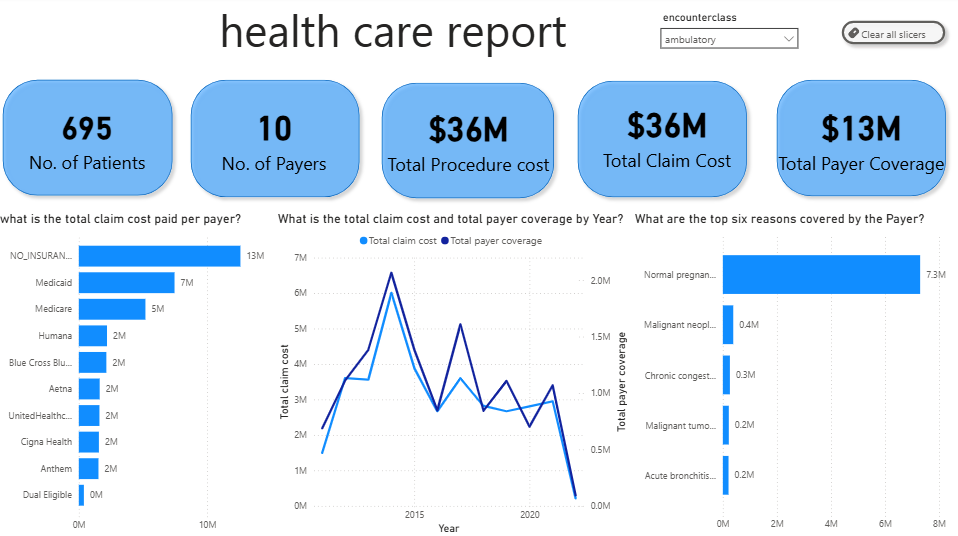
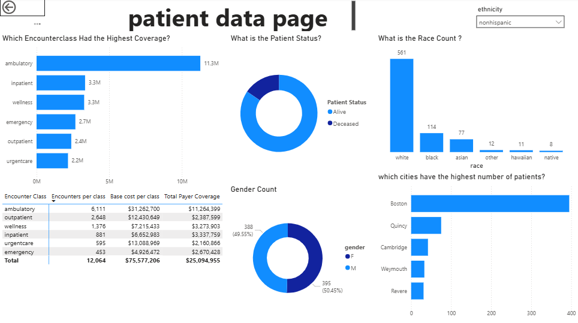

# 🏥 Hospital Patient Records Analysis

[](https://www.postgresql.org/)
[](https://www.postgresql.org/)
[](https://powerbi.microsoft.com/)
[](https://dbeaver.io/)
[]()
[]()

---

## 📌 Project Overview

This project analyzes hospital patient records to explore healthcare utilization, encounter patterns, procedure costs, payer coverage, patient demographics, and readmission behavior.

The project was developed using a **SQL-first analytical workflow**, with SQL used to query and transform the underlying relational data before bringing the resulting analysis into Power BI for visualization and interactive exploration.

The project demonstrates an end-to-end workflow:

**Healthcare Dataset → SQL Analysis → Analytical Views → Power BI → Insights**

The initial analysis focuses on answering defined business questions around encounters, costs, payer coverage, and patient behavior.

A key objective of the project was also to begin moving beyond simple reporting by using the findings to identify more meaningful analytical questions for future investigation.

---

# 📑 Table of Contents

- [Project Overview](#-project-overview)
- [Business Context](#-business-context)
- [Dataset](#-dataset)
- [Project Objectives](#-project-objectives)
- [SQL Analysis](#-sql-analysis)
- [Power BI Analysis](#-power-bi-analysis)
- [Key Findings](#-key-findings)
- [From Reporting to Analytics](#-from-reporting-to-analytics)
- [Future Analytical Questions](#-future-analytical-questions)
- [Tools & Technologies](#-tools--technologies)
- [Project Workflow](#-project-workflow)
- [Project Outcome](#-project-outcome)
- [Future Extensions](#-future-extensions)
- [Author](#-author)

---

# 🎯 Business Context

Healthcare organizations generate large volumes of patient, encounter, procedure, and financial data.

Basic reporting can tell us:

- How many patients were treated
- How many encounters occurred
- How much was spent
- Which procedures were performed
- How much payers covered

However, these metrics provide only a descriptive view of healthcare activity.

This project therefore uses the initial reporting analysis as a foundation for asking deeper analytical questions about healthcare utilization, expenditure, payer coverage, and patient behavior.

---

# 🗂 Dataset

The project uses the **Hospital Patient Records** dataset available on Kaggle.

The dataset contains interconnected information relating to:

| Data Area | Examples |
|---|---|
| Patients | Demographics, birth date, death date, gender, race, ethnicity |
| Encounters | Encounter dates, encounter class, organization, payer, costs |
| Procedures | Procedures performed and associated costs |
| Organizations | Healthcare organizations and locations |
| Payers | Insurance and healthcare financing information |

> **Note:** The dataset is synthetic and should not be interpreted as representing actual patient populations or real-world healthcare outcomes.

---

# 🎯 Project Objectives

The SQL analysis was structured around three major objectives.

## 1. Encounters Overview

### Questions

- How many total encounters occurred each year?
- For each year, what percentage of encounters belonged to each encounter class?
- What percentage of encounters were over 24 hours versus under 24 hours?

Encounter classes included:

- Ambulatory
- Outpatient
- Wellness
- Urgent Care
- Emergency
- Inpatient

---

## 2. Cost & Coverage Insights

### Questions

- How many encounters had zero payer coverage?
- What percentage of total encounters had zero payer coverage?
- What were the 10 most frequently performed procedures?
- What was the average base cost of those procedures?
- Which 10 procedures had the highest average base cost?
- How frequently were those high-cost procedures performed?
- What was the average total claim cost by payer?

---

## 3. Patient Behavior Analysis

### Questions

- How many unique patients were admitted each quarter?
- How many patients were readmitted within 30 days of a previous encounter?
- Which patients had the highest number of readmissions?

---

# 🧮 SQL Analysis

SQL was the primary analytical tool used in the project.

The analysis involved querying multiple related tables to produce meaningful healthcare metrics and analytical views.

### SQL techniques used

- `SELECT`
- `WHERE`
- `GROUP BY`
- `ORDER BY`
- `JOIN`
- `LEFT JOIN`
- `CASE WHEN`
- Common Table Expressions (CTEs)
- Aggregate functions
- Date functions
- Subqueries
- Window functions
- Ranking
- Conditional aggregation

### Examples of analytical work

SQL was used to:

- Calculate annual encounter volumes
- Determine encounter-class proportions
- Calculate encounter duration
- Identify encounters with zero payer coverage
- Rank procedures by frequency
- Compare procedure costs
- Calculate payer-level claim costs
- Analyze quarterly patient admissions
- Identify 30-day readmissions
- Rank patients by readmission frequency

---

# 📊 Power BI Analysis

The SQL outputs were subsequently brought into Power BI to create an interactive analytical report.

### Current report areas include:

#### Healthcare Financial Overview

- Number of patients
- Number of payers
- Total procedure cost
- Total claim cost
- Total payer coverage
- Claim cost by payer
- Claim cost and payer coverage over time
- Reasons covered by payers

#### Patient & Encounter Analysis

- Patient status
- Gender distribution
- Race distribution
- Patient distribution by city
- Encounter-class volume
- Encounter-class cost
- Encounter-class payer coverage

Interactive slicers allow the report to be explored across dimensions such as encounter class and ethnicity.

---

# 🔎 Key Findings

The Power BI report provides an initial descriptive view of healthcare utilization and financial patterns.

### Healthcare Costs

The analysis shows substantial variation in claim costs across payers and encounter classes.


### Payer Coverage

Payer coverage differs across encounter categories, creating an opportunity to investigate the relationship between claim costs and the proportion covered by payers.

### Encounter Classes

Encounter classes differ in their contribution to:

- Encounter volume
- Base cost
- Claim cost
- Payer coverage

### Patient Demographics

The dataset allows patient activity to be examined across:

- Age
- Gender
- Race
- Ethnicity
- Location
- Patient status

These dimensions provide the foundation for deeper analysis of healthcare utilization.

---

# 🧠 From Reporting to Analytics

One of the main learning outcomes from this project was recognizing the difference between **reporting a pattern** and **investigating a pattern**.

For example:

### Reporting

> Which encounter class has the highest number of encounters?

### Deeper analytical question

> What patient and encounter characteristics are associated with higher utilization of particular encounter classes?

---

### Reporting

> Which payer has the highest claim cost?

### Deeper analytical question

> How does payer coverage relative to claim cost vary across encounter types and patient populations?

---

### Reporting

> Which patients have the most readmissions?

### Deeper analytical question

> What characteristics are associated with frequent readmission?

---

### Reporting

> Which procedures have the highest costs?

### Deeper analytical question

> What patient, encounter, or procedure characteristics are associated with higher healthcare expenditure?

This shift in questioning represents the next step in my development as a data analyst:

**From describing data → to investigating relationships within data.**

---

# 🔬 Future Analytical Questions

The current project establishes the descriptive baseline. Future analysis could investigate questions such as:

## Patient Utilization

- What characteristics are associated with high healthcare utilization?
- Which patient characteristics are associated with emergency encounter utilization?
- What distinguishes high-utilization patients from lower-utilization patients?

## Healthcare Expenditure

- What patient, encounter, procedure, and payer characteristics are associated with higher healthcare expenditure?
- Are high-cost encounters concentrated within particular patient or procedure groups?
- Which combinations of procedures and diagnoses are associated with higher costs?

## Payer Coverage

- How does payer coverage relative to claim cost vary across encounter types?
- Which patient and encounter characteristics are associated with greater estimated uncovered costs?

## Readmissions

- What characteristics are associated with 30-day readmission?
- Are frequent readmissions concentrated within particular patient groups?

## Demographic Patterns

- How does healthcare utilization vary across demographic groups?
- What factors may be associated with observed differences in utilization?

> These questions would require additional analytical techniques and should be interpreted as **associations rather than causal relationships** unless supported by an appropriate causal research design.

---

# 🛠 Tools & Technologies

| Tool | Purpose |
|---|---|
| **SQL** | Data querying, transformation and analysis |
| **PostgreSQL** | Relational database environment |
| **DBeaver** | SQL development and database management |
| **Power BI** | Data visualization and interactive reporting |
| **Excel** | Data inspection and validation |
| **Kaggle** | Dataset source |

---

# 🔄 Project Workflow

```text
Kaggle Dataset
      │
      ▼
Data Exploration
      │
      ▼
SQL Analysis
      │
      ├── Encounter Analysis
      ├── Cost Analysis
      ├── Payer Analysis
      └── Patient Behavior Analysis
      │
      ▼
Analytical SQL Views
      │
      ▼
Power BI
      │
      ├── KPI Development
      ├── Visual Analysis
      ├── Interactive Filtering
      └── Data Storytelling
      │
      ▼
Deeper Analytical Questions
```

# 📌 Project Outcome

This project demonstrates an end-to-end healthcare data analytics workflow, transforming relational healthcare data into actionable insights through **SQL analysis and Power BI visualization**.

The project successfully:

- Analyzed healthcare encounter patterns using SQL
- Examined encounter volumes across different encounter classes
- Analyzed healthcare expenditure and procedure costs
- Evaluated payer coverage and claim costs
- Investigated patient admission and readmission patterns
- Created reusable analytical SQL views
- Transformed SQL outputs into an interactive Power BI report
- Developed KPIs and visualizations for healthcare utilization and financial analysis
- Explored demographic and geographic characteristics of the patient population

Beyond the technical implementation, the project reinforced an important analytical principle:

> **Good analytics does not stop at describing what happened; it uses observed patterns to identify better questions about what may be associated with those patterns.**

The completed Power BI report therefore represents the **descriptive and exploratory stage** of the project. The patterns identified provide a foundation for deeper diagnostic, statistical, and predictive analysis in future iterations.

---

# 🚀 Future Analytical Extensions

The completed analysis creates several opportunities for deeper analytical development.

## 🔎 Diagnostic Analytics

Future analysis can investigate characteristics associated with:

- High healthcare utilization
- Emergency encounter utilization
- High healthcare expenditure
- Differences in payer coverage
- Greater estimated patient responsibility
- Frequent readmissions
- Differences in healthcare utilization across demographic groups

The analytical focus can progressively move from:

> **What happened?**

toward:

> **What characteristics and factors are associated with what happened?**

This distinction is important because associations observed in the dataset should not automatically be interpreted as causal relationships.

---

## 📊 Statistical Analysis

Where appropriate, future work may incorporate statistical methods such as:

- Hypothesis testing
- Chi-square tests
- Correlation analysis
- t-tests
- ANOVA
- Regression analysis
- Logistic regression
- Count-data models

These methods can help assess whether observed differences or associations are statistically meaningful rather than relying solely on descriptive patterns.

Any statistical conclusions would be interpreted within the limitations of the dataset, including its synthetic and observational nature.

---

## 🤖 Predictive Analytics

A future extension could explore predictive questions such as:

- Which patients are more likely to become high-utilization patients?
- Which characteristics are associated with higher healthcare expenditure?
- Can patient and encounter characteristics help predict 30-day readmission?

Potential approaches could include:

- Classification
- Regression
- Patient segmentation
- Feature engineering
- Model evaluation and validation

This would extend the project from **describing historical patterns** toward evaluating whether available patient and encounter characteristics can support predictive modeling.

---

## 📈 Power BI Development

The Power BI report can also be expanded to include:

- Advanced DAX measures
- Drill-through analysis
- Interactive analytical navigation
- Dynamic KPIs
- Patient utilization segmentation
- Cost-driver analysis
- Payer coverage analysis
- Readmission analysis
- Dedicated diagnostic-analysis pages

The longer-term objective is to evolve the dashboard from an exploratory reporting solution into a more comprehensive **healthcare analytics and decision-support platform**.

> **Note:** Because the dataset is synthetic and observational, future findings will be interpreted as patterns and associations within the dataset. They should not automatically be interpreted as evidence of causal relationships or generalized to real-world patient populations.

---

# 🛠 Tools & Technologies

| Tool | Purpose |
|---|---|
| **SQL** | Data querying, transformation, and analysis |
| **PostgreSQL** | Relational database environment |
| **DBeaver** | SQL development and database management |
| **Power BI** | Data visualization and interactive reporting |
| **Excel** | Data inspection and validation |
| **Kaggle** | Dataset source |

---

# 👨‍💻 Author

**SSENKUNGU IBRAHIM**

**Data Analyst \|Pharmacist \| pharmacy technician \| Healthcare Data Analytics \| SQL \| Power BI**

I am interested in applying data analytics to healthcare, pharmaceutical problems, finance, combining healthcare domain knowledge with SQL, business intelligence, and analytical thinking.

This project represents healthcare-focused analysis toward **data-driven problem solving and healthcare analytics**, with a focus on using data to understand healthcare utilization, costs, patient behavior, and operational patterns.

[def]: /health%20care%20image%20one.png